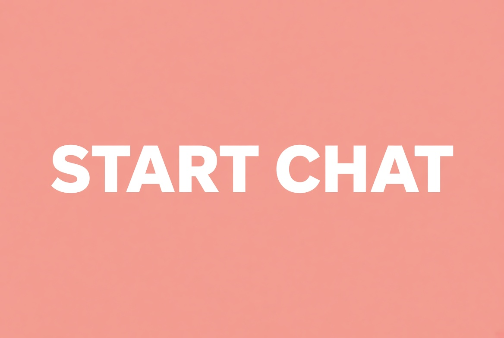

<h1>Kupid AI: My One-Week Experience</h1>

<h3>A week with an AI companion. Chat, images, voice. What actually happened. 18+.</h3>

  

---

What I tried

I spent a week on Kupid AI, the browser companion at kupid.ai. The pitch is simple: pick a ready character or build your own, then chat, get images, and on paid plans hear voice messages and short clips. I wanted to see if a week is enough to tell whether it is worth paying for.

The free start is small. Reviews of the live product put it around 15 messages, no photos, no voice. Enough to see the tone. Not enough to live in it. After that you are looking at Pro or Ultra. Weekly billing looks cheap on the sticker and adds up if you stay on the weekly rate. Yearly is where the price drops. Check the plan screen yourself. Numbers move.

It runs in the browser. Desktop and phone. 18+ only.

---

≡ START CHAT ≡

---

Day by day

Day 1. I opened the site and built a character instead of taking a preset. Style, face, personality, a name. The creator is the strongest first impression. You can see what you are making before the chat starts.

Day 2. Chat. The tone is companion-first, not a work assistant. It stays in the scene if you stay in the scene. Free messages ran out fast. That is the point of the free tier: a demo, not a habit.

Day 3. I looked at images. They sit inside the chat, tied to the character, which is better than a separate generator. Quality depends on the prompt and the plan. Do not expect a studio.

Day 4. Voice. This is the feature people mention most. Voice messages are on paid plans, with a weekly minute cap. If voice is why you came, this is the test. If you only want text, you are paying for something you will not use.

Day 5. Memory. Free keeps a short window. Pro is longer. Ultra advertises a much larger one. In a week you notice when it forgets a name and when it does not. Treat the big numbers as a plan claim and judge them in use.

Day 6. Billing. I read the upgrade screen twice. Weekly Pro is the trap. It looks like a few dollars and becomes a large year if you never switch. Yearly is the number to compare.

Day 7. I stopped and wrote this. A week is enough to know if the character and the voice fit. It is not enough to call it a relationship.

[Open Kupid AI](https://chubby-gf.com/kupid)

---

What stood out

Character builder  
Realistic or anime, face, body, personality, role. You are not stuck with one preset girl. That is the main reason to open it.

Chat in the browser  
No install. The thread stays with the character you made.

Images in the chat  
Stills of the same character, on plans that include them. Weekly quotas, not an unlimited tap.

Voice  
The feature that separates it from a text-only bot. Capped by minutes on the plan.

Memory that scales with the plan  
Short on free, longer on Pro, largest on Ultra. Confirm the current window on the site.

---

---

What I would tell a friend

Use the free messages first. If the tone is wrong, stop. If the tone is right and you want voice or pictures, open the plan page and do the yearly math, not the weekly sticker.

Skip it if you want a huge library of community characters, a general chatbot, or therapy. This is an adult companion product. Do not put real names or contacts in the chat.

[Try Kupid AI](https://chubby-gf.com/kupid)

---

At a glance

| Topic | What to know |
| --- | --- |
| Product | Kupid AI, kupid.ai |
| Best for | Custom companion, chat, voice, images |
| Style | Realistic or anime |
| Free | Small message demo, no media |
| Paid | Pro and Ultra, weekly or yearly |
| Age | 18+ only |

---

Pricing, the part that matters

Free is a short demo. Pro and Ultra add messages, memory, photos, video clips and voice minutes. Weekly rates look low and cost more over a year. Yearly rates are the ones to compare. Prices change. Open the live plan page before you pay.

[See Kupid AI plans](https://chubby-gf.com/kupid)

---

Pros and cons after a week

Pros

- Detailed character builder
- Chat, images and voice in one browser product
- Voice is a real feature, not a checkbox
- Free tier to test the tone
- Works on phone

Cons

- Free tier is a demo
- Weekly billing adds up
- Media is quota based
- Adult product, keep personal data out
- Not a substitute for a real person

---

FAQ

What is Kupid AI?  
An 18+ AI companion site. You build or pick a character and chat in the browser, with images and voice on paid plans.

Is it free?  
A small free start. Media and longer memory are paid.

Is the voice worth it?  
If voice is why you came, yes, test it. If you only want text, you may not need the paid tier.

Is this the official page?  
No. This is an independent one-week writeup. Links go to the product.

---

Keywords

`Kupid AI` · `kupid.ai` · `Kupid AI review` · `Kupid AI experience` · `AI girlfriend` · `AI companion` · `AI girlfriend chat` · `custom AI girlfriend` · `AI voice messages` · `AI image generation` · `anime AI girlfriend` · `realistic AI girlfriend` · `Kupid AI pricing` · `Kupid AI free` · `AI companion browser` · `18+ AI chat` · `AI boyfriend` · `create AI girlfriend` · `Kupid Pro` · `Kupid Ultra`

---

Conclusion

A week on Kupid AI is enough to know two things. The character builder and the chat are the product. The weekly price is the catch. Try the free messages, then decide on a plan with the yearly number in front of you.

---

<h2>≡ START CHAT ≡</h2>

<h3>Open Kupid AI and see the tone for yourself. 18+.</h3>

  

<strong>Kupid AI - My One-Week Experience. Independent overview.</strong>

  
  

---

License  
Independent overview. Product name belongs to its owner.
